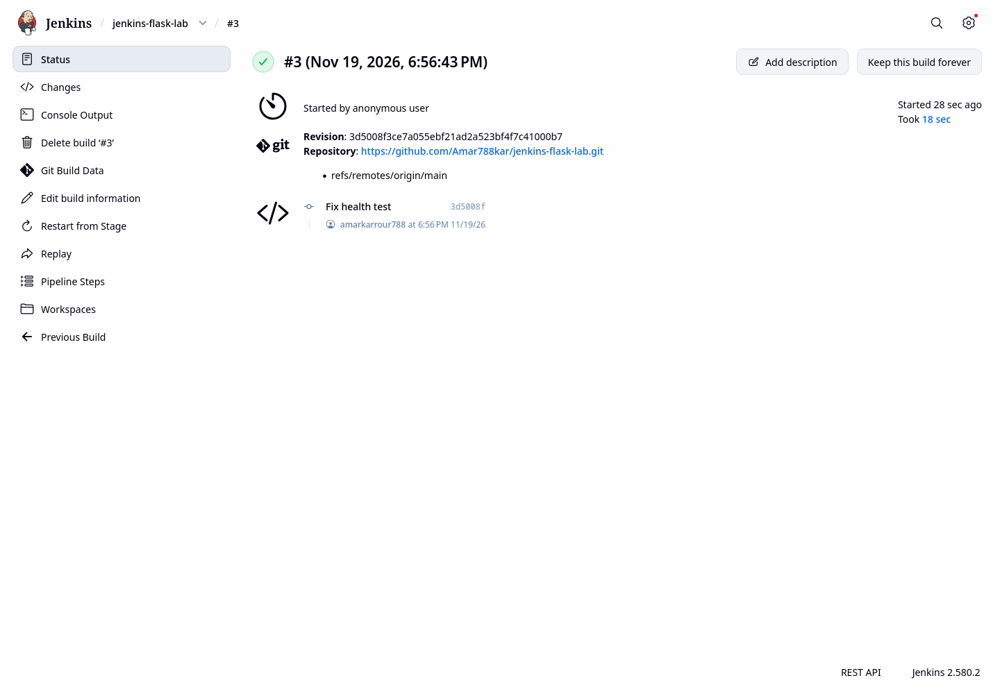
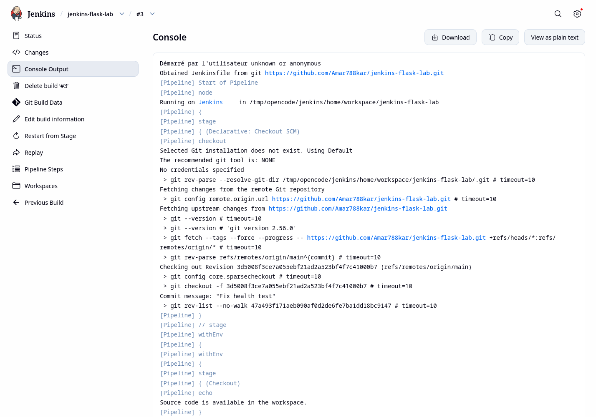
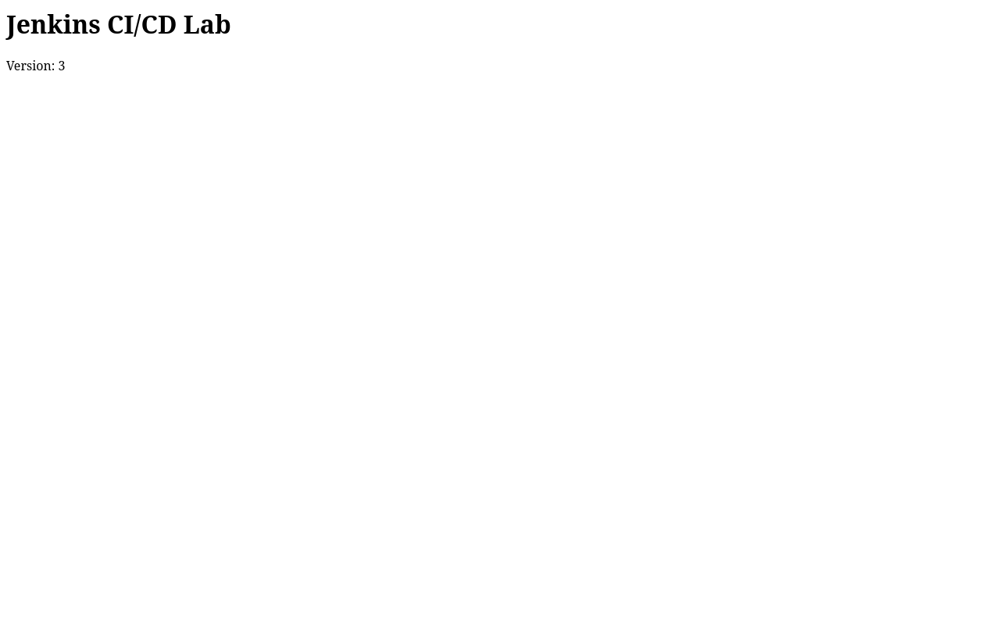
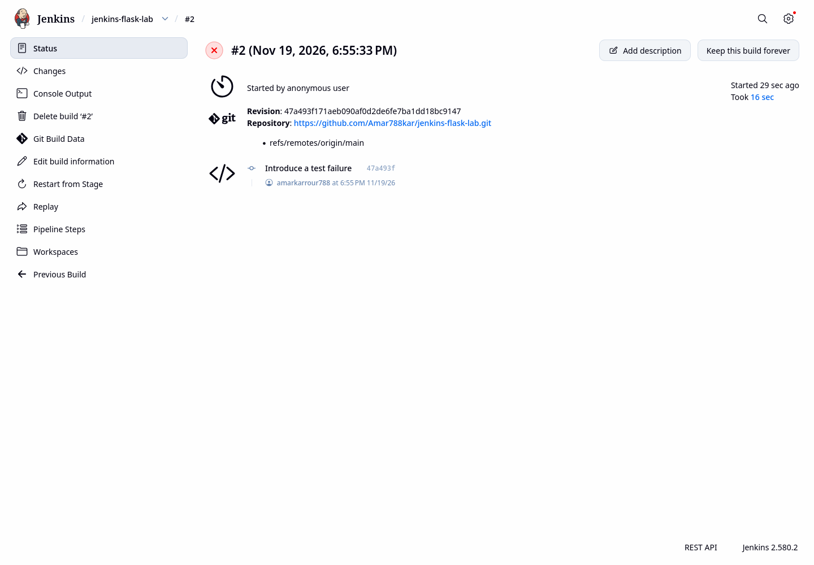
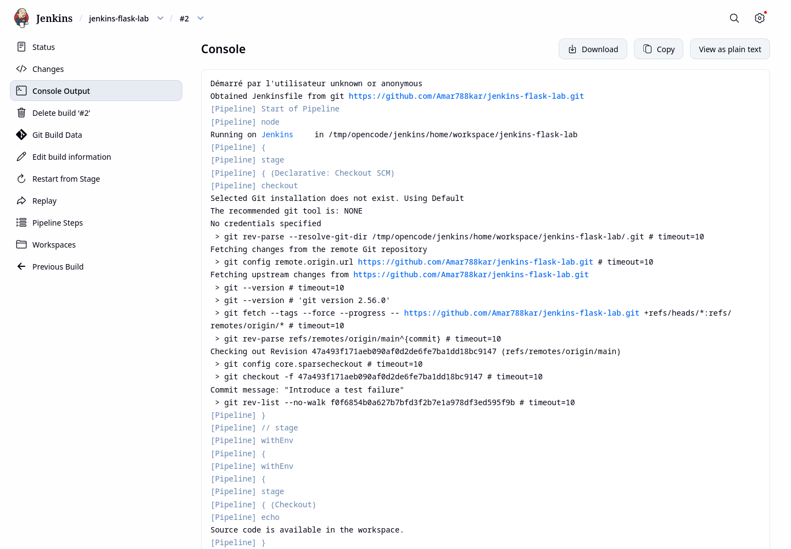

# Rapport — Lab 07 : Building a CI/CD Pipeline with Jenkins and Docker

Dépôt : https://github.com/Amar788kar/jenkins-flask-lab

## 1. Architecture et fonctionnement

Le flux est le suivant : **GitHub → Jenkins Pipeline → image Docker → conteneur Docker → application Flask**.

Jenkins est configuré en « Pipeline script from SCM » : à chaque build, il clone le dépôt
`main`, lit le `Jenkinsfile` à la racine, puis exécute les étapes dans l'ordre. L'application est
exposée sur le port 8081 de l'hôte (correspondance `8081:8000`), tandis que Jenkins écoute normalement sur 8080.

### Les cinq étapes

| Étape | Commande / action | Résultat attendu |
|---|---|---|
| Checkout | Le job clone le dépôt ; l'étape affiche simplement un message. | `app.py`, `Dockerfile`, `tests/` et le `Jenkinsfile` sont présents dans le workspace. |
| Build | `docker build -t ${IMAGE_NAME}:${BUILD_NUMBER} .` | Image `jenkins-flask-lab:<numéro de build>` créée. |
| Test | `docker run --rm ${IMAGE_NAME}:${BUILD_NUMBER} pytest -v` | Les 2 tests passent ; le conteneur temporaire est supprimé. |
| Deploy | `docker rm -f ${CONTAINER_NAME} || true` puis `docker run -d --name ... -p 8081:8000 -e APP_VERSION=${BUILD_NUMBER} ...` | Ancien conteneur remplacé, nouveau conteneur démarré en arrière-plan. |
| Verify | `curl --fail --retry 10 --retry-delay 2 .../health` puis `curl --fail .../` | `/health` renvoie `{"status":"ok"}` et `/` renvoie la page avec le numéro de build. |

Le bloc `post` affiche un message selon le résultat (`success` / `failure`).

### Expérience de défaillance

En remplaçant temporairement l'assertion par `{"status": "incorrect"}`, l'étape **Test** échoue.
Jenkins arrête alors immédiatement le pipeline : **Deploy** et **Verify** ne sont jamais exécutés.
Le conteneur précédent continue donc de tourner : une version défectueuse n'est jamais publiée.
Après correction de l'assertion et nouveau build, le pipeline redevient `SUCCESS`.

## 2. Questions — section 19 : Blue-Green deployment

**Différence entre deployment et release.** Le *deployment* est le fait d'installer et de lancer
une nouvelle version dans un environnement (les fichiers sont en place, le processus tourne). La
*release* est le moment où cette version est réellement exposée aux utilisateurs. En Blue-Green,
on déploie sur Green sans encore le publier : les deux opérations sont découplées.

**Pourquoi déployer sur Green avant de recevoir le trafic ?** Pour valider la nouvelle version
(tests, health checks, observations) dans un environnement réel mais isolé. Ainsi, une version
cassée ne perturbe pas les utilisateurs : le trafic reste sur Blue, qui fonctionne.

**Quel composant route les requêtes vers Blue ou Green ?** Un reverse proxy / load balancer,
typiquement NGINX (ou HAProxy, un Ingress Kubernetes, un ELB...). Il suffit de changer sa
configuration (ou un `upstream`) pour basculer le trafic.

**Pourquoi conserver Blue après la bascule ?** Pour permettre un rollback immédiat : si Green
présente un défaut non détecté, on redirige simplement le trafic vers Blue, qui tourne toujours
avec la version connue comme fonctionnelle. On ne supprime Blue qu'après une période d'observation.

**Comment Jenkins automatise-t-il ces étapes ?** Le pipeline enchaîne : build de l'image, tests,
déploiement sur l'environnement Green, tests d'acceptation/health checks sur Green, puis une étape
de validation (par exemple `input` pour une approbation manuelle), puis le basculement du proxy
(rechargement de NGINX) et enfin les vérifications post-bascule. Chaque étape peut déclencher un
rollback automatique en cas d'échec.

**Principal avantage du rollback en Blue-Green ?** Le retour à la version précédente est rapide
et peu risqué : il s'agit d'un simple changement de routage, sans réinstallation ni redéploiement.
Le temps d'indisponibilité et le risque d'erreur sont minimisés.

## 3. Questions — section 20

**Qu'est-ce que Jenkins et quel problème résout-il ?** Jenkins est un serveur d'automatisation
open source. Il exécute des tâches répétitives (récupération du code, compilation, tests,
construction d'images, déploiement) de manière reproductible et traçable. Il résout le problème
des intégrations manuelles : erreurs humaines, absence d'historique et retard dans la détection
des régressions.

**Rôle d'un Jenkinsfile ?** C'est la définition du pipeline, stockée avec le code source (pipeline
as code). Jenkins le lit pour connaître les étapes à exécuter. Étant versionné dans Git, il est
relu, relu en revue et restaure avec le projet.

**CI vs CD.** La *Continuous Integration* consiste à intégrer fréquemment les modifications dans
une branche partagée, avec un build et des tests automatiques à chaque commit. La *Continuous
Delivery* va plus loin : après les tests, chaque validation passe produit est automatiquement
prête à être publiée (déploiement automatisé, souvent avec une approbation manuelle avant la mise
en production). La *Continuous Deployment* supprime même cette approbation.

**Rôle de GitHub ici ?** GitHub héberge le code source et le Jenkinsfile. Il sert de source de
vérité : Jenkins clone le dépôt à chaque build. Le dépôt public évite la gestion d'identifiants
pour cet exercice.

**Pourquoi Docker dans le pipeline ?** Docker fournit un environnement identique pour les tests
et l'exécution : mêmes dépendances, même version de Python, peu importe la machine Jenkins. L'image
taguée avec le numéro de build est aussi un artefact immuable et reproductible que l'on peut
déployer ou remplacer facilement.

**Pourquoi exécuter les tests avant le déploiement ?** Pour appliquer le principe « fail fast » :
si le code est cassé, le pipeline s'arrête et l'ancienne version reste en service. On évite ainsi
de publier une version défectueuse et de perdre du temps sur un déploiement inutile.

**Que se passe-t-il si une étape échoue ?** Jenkins arrête le pipeline à cette étape (par défaut),
marque le build `FAILURE`, exécute le bloc `post { failure { ... } }` et n'exécute pas les étapes
suivantes. Les journaux de la console permettent d'identifier l'étape fautive.

**Rôle de l'étape Verify ?** Confirmer que le déploiement a réellement fonctionné du point de vue
HTTP : le endpoint `/health` répond (avec des retries pour laisser le conteneur démarrer) et la page
d'accueil est accessible. Un conteneur « démarré » n'est pas forcément « fonctionnel ».

**Pourquoi ne pas stocker d'identifiants dans le Jenkinsfile ?** Le Jenkinsfile est versionné et
visible par tous ceux qui ont accès au dépôt (et souvent dans les journaux de build). Il faut
utiliser les *Credentials* de Jenkins référencés par leur ID (`withCredentials`, `usernamePassword`,
etc.) afin de ne jamais exposer de mot de passe ou de token en clair.

## 4. Limites connues / pistes d'amélioration

- Le pipeline de ce lab déploie un seul conteneur ; le Blue-Green reste conceptuel (voir section 19).
- Ajouter `--retry-connrefused` au `curl` de vérification rendrait l'étape Verify plus robuste.
- En production : analyser les dépendances et l'image (security scanning), approbation manuelle,
  monitoring/alerting, sauvegardes, rollback automatisé et webhook GitHub (si Jenkins est joignable).
- Le compte Jenkins doit avoir accès au daemon Docker ; ceci doit rester limité à une machine
  pédagogique isolée, jamais à un serveur partagé.

## 5. Captures d'écran

Les captures ont été réalisées sur une instance Jenkins locale isolée (port 8082, le port 8080
étant occupé par Nextcloud sur cette machine), avec le même job « Pipeline script from SCM »
pointant sur https://github.com/Amar788kar/jenkins-flask-lab.

### Build réussi (build n° 3) — les cinq étapes sont vertes





### Application déployée (http://localhost:8081, version = n° de build)



### Build échoué (build n° 2) — étape Test en rouge





**Explication :** l'assertion `{"status": "ok"}` a été remplacée par `{"status": "incorrect"}`
dans `tests/test_app.py`, puis poussée sur GitHub. Le build n° 2 a exécuté Checkout, Build puis
Test ; pytest a échoué :

```
E   AssertionError: assert {'status': 'ok'} == {'status': 'incorrect'}
========================= 1 failed, 1 passed in 0.62s ==========================
```

Jenkins a alors arrêté le pipeline. La console indique explicitement :

```
[Pipeline] { (Deploy)
Stage "Deploy" skipped due to earlier failure(s)
[Pipeline] { (Verify)
Stage "Verify" skipped due to earlier failure(s)
Finished: FAILURE
```

Aucune nouvelle image n'a donc été déployée et le conteneur de la version précédente est resté
en service. L'assertion a ensuite été corrigée et poussée (`Fix health test`) ; le build n° 3
est repassé en `SUCCESS` et sert de capture de réussite ci-dessus.
